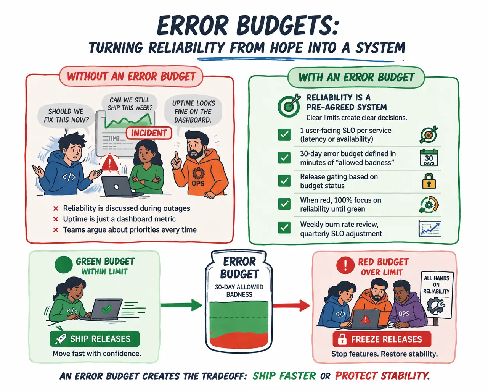

---
# Generated by `npm run import` from the Obsidian vault.
# Edit the vault note, not this file: the next import overwrites it.
importedFrom: "articles/platform-engineering/error-budgets.md"
title: "Error Budgets: Turning Reliability from Hope into a System"
description: "If you ship without an error budget, your “reliability” is just hope."
pubDate: 2026-03-27
category: "platform-engineering"
tags: ["sre", "error-budgets", "reliability"]
draft: true
legacyUrls: ["/benefits-of-aerobic-exercise-for-the-mind-and-body/"]
---

If you ship without an error budget, your “reliability” is just hope.

This is for DevOps teams drowning in incidents while still pushing weekly releases.

Most orgs treat uptime as a dashboard metric, then argue about priorities during every outage.\
SLOs only work when they create a real tradeoff: ship faster or protect stability.

Here’s the simplest system I’ve seen actually change behavior:

Define 1 user-facing SLO per service (latency or availability), not 12 internal ones.\
Turn it into a 30-day error budget in minutes of “allowed badness.”\
Gate releases on budget status: green ships, red freezes.\
When red, spend 100% of engineering time on reliability until green again.\
Review burn rate weekly, and adjust SLOs only quarterly.

The uncomfortable part is the point: product loses autonomy when customers feel pain. \
You stop negotiating reliability in meetings and start enforcing it in process.

If you want one lever that aligns Dev, Ops, and Product, make the error budget real.

What this really means is that reliability shouldn’t be something teams debate during outages—it should already be decided ahead of time. An error budget gives you a clear boundary: how much failure is acceptable before you must stop shipping and fix stability. Without that boundary, teams default to pushing features and reacting to problems later. With it, decisions become automatic. If you’re within budget, you can move fast. If you’ve exceeded it, reliability becomes the only priority until service health is restored. This removes guesswork, reduces conflict between teams, and forces a consistent balance between speed and stability.
