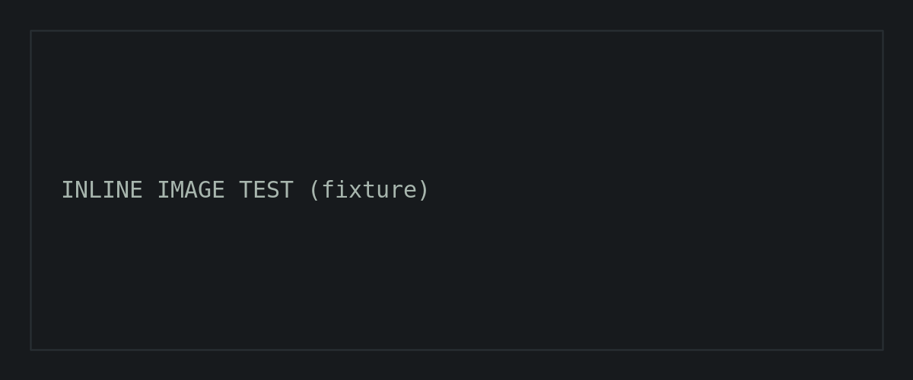

This page is a formatting reference for the Ninjatronics blog engine. It exists to
check typography and components during development and is never published.
Body text uses Inter at a comfortable reading measure, with **bold**, *italic*,
`inline code`, <kbd>Ctrl</kbd> + <kbd>C</kbd>, and [an external link](https://astro.build).

## Headings and lists

Second-level headings carry the vermilion section marker and appear in the
table of contents. Third-level headings appear indented.

### Unordered list

- A first item with enough text to wrap onto a second line on narrow screens, to check the hanging indent.
- A second item
  - A nested item

### Ordered list

1. First step
2. Second step
3. Third step

> A blockquote, for quoting documentation or another author.

## Code blocks

A shell session. The copy button copies only the commands (lines starting with
`$ `), drops the prompt, and keeps continuation lines that follow a trailing `\`:

```bash
$ systemctl status nginx --no-pager
● nginx.service - A high performance web server
     Active: active (running)
$ journalctl -u nginx \
    --since "10 min ago" \
    --no-pager
$ echo "done"
done
```

A plain script with no prompts copies exactly as written:

```bash
#!/usr/bin/env bash
set -euo pipefail
for host in web-01 web-02; do
  ssh "$host" 'uptime'
done
```

YAML:

```yaml
apiVersion: v1
kind: ConfigMap
metadata:
  name: example
  namespace: default
data:
  LOG_LEVEL: "info" # comment
  RETRIES: "3"
```

TypeScript:

```ts
interface Check {
  name: string;
  timeoutMs: number;
}

export async function run(checks: Check[]): Promise<boolean> {
  const results = await Promise.all(checks.map((c) => probe(c.name, c.timeoutMs)));
  return results.every(Boolean);
}
```

A deliberately long line, to confirm horizontal scrolling instead of page overflow:

```text
this-is-a-deliberately-long-single-line-of-text-that-must-scroll-horizontally-inside-the-code-block-rather-than-widening-the-page-or-wrapping-0123456789
```

## Callouts

<Callout type="note">
  A note adds context the reader may want, without interrupting the main flow.
</Callout>

<Callout type="tip" title="Optional title">
  A tip offers a shortcut or a better approach.
</Callout>

<Callout type="warning">
  A warning flags something that can cause data loss or an outage, such as running `rm -rf` against the wrong path.
</Callout>

## Tables and images

| Column | Purpose | Example |
| ------ | ------- | ------- |
| Name | Identifier | `web-01` |
| Role | What it does | Reverse proxy |
| A longer cell value to check wrapping | Notes | `--flag=value` |



## Closing section

A fourth section heading, so this fixture always crosses the three-section
threshold that turns on the automatic table of contents.
